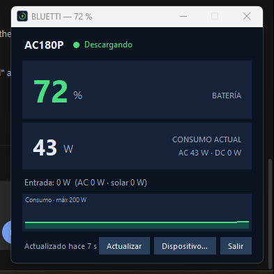
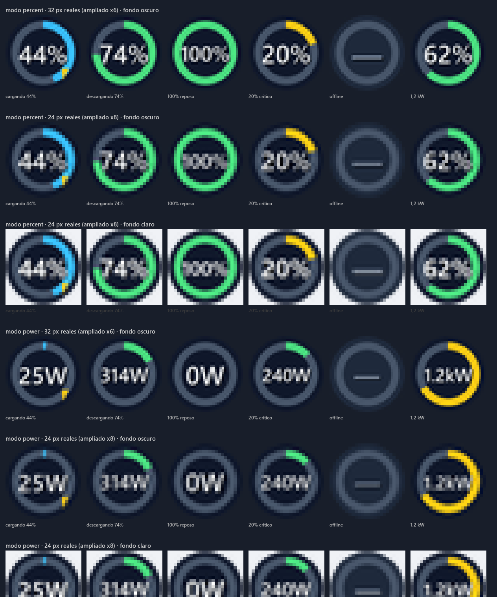
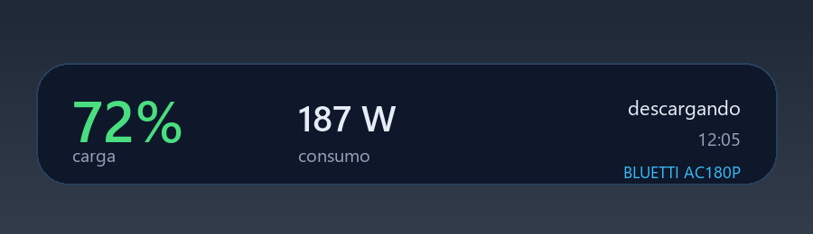

# BluettiTray — estado del BLUETTI AC180P en la bandeja de Windows

Programa no oficial para Windows que se conecta **por Bluetooth LE** a una
estación de energía **BLUETTI AC180P** y muestra en la bandeja del sistema:

- **el porcentaje de carga** de la batería,
- **el consumo actual** (salida AC + salida DC en vatios),
- la **entrada de carga** (red eléctrica y solar), el estado (cargando,
  descargando, en reposo) y el historial reciente de consumo.

No usa la nube, no requiere la app oficial de BLUETTI y no hay que emparejar el
equipo en Windows: la aplicación habla directamente el protocolo MODBUS sobre
BLE del equipo.





---

## 1. Cómo funciona

- El AC180P (y otros equipos BLUETTI de la familia "V2") expone un servicio
  BLE propietario con las características `ff01` (notificaciones) y `ff02`
  (escritura). Las lecturas son tramas **MODBUS RTU** (`01 03 ...` + CRC16).
- La aplicación usa la librería [`bluetti-bt-lib`](https://github.com/Patrick762/bluetti-bt-lib)
  (MIT), que ya implementa el mapa de registros del AC180P y el *handshake*
  cifrado que usan algunas unidades.
- Cada actualización abre una conexión BLE, lee 6 bloques de registros y se
  desconecta. Tarda entre **8 y 25 segundos** según el equipo y el adaptador.
  Por eso el intervalo por defecto es 60 s y se puede cambiar.
- El equipo **solo admite una conexión BLE a la vez**: mientras se está leyendo,
  la app oficial de BLUETTI en el móvil puede no conectar. Entre lecturas la
  conexión queda libre.
- Si el equipo cambia de dirección Bluetooth (algunos usan direcciones
  aleatorias), la app lo reencuentra por el nombre anunciado y guarda la
  dirección nueva automáticamente.

**Consumo actual** = potencia de salida AC + salida DC (lo que están
consumiendo tus aparatos enchufados). **Entrada** = red eléctrica (AC) + solar
(DC); si es mayor que cero, la batería se está cargando.

---

## 2. Requisitos

- Windows 10/11 con Bluetooth LE (probado en Windows 11).
- El AC180P **encendido** y con Bluetooth visible (en algunos firmwares el BLE
  se apaga en reposo; dale al botón de encendido).
- Para usar el ejecutable ya compilado: nada más.
- Para ejecutar desde el código: Python 3.11/3.12.

---

## 3. Uso

### Con el ejecutable

1. Ejecuta `dist\BluettiTray.exe`.
2. La primera vez aparece el selector de dispositivos: enciende el AC180P,
   espera el escaneo, selecciona el equipo y pulsa **Usar seleccionado**.
   (Si la lista sale vacía, pulsa **Escanear de nuevo**; asegúrate de que el
   equipo está encendido y cerca.)
3. El icono aparece en la bandeja del sistema y empieza a actualizarse.

> **Windows 11 oculta los iconos nuevos.** Si no ves el icono, pulsa la flecha
> `^` de la bandeja y arrastra el icono de BluettiTray a la barra, o ve a
> *Configuración → Personalización → Barra de tareas → Otros iconos del
> sistema* y actívalo.

### Interacción

| Acción | Resultado |
| --- | --- |
| Pasar el ratón por el icono | Tooltip con carga, consumo y estado |
| Clic izquierdo | Abre el panel de detalle |
| Clic derecho | Menú: actualizar, elegir icono (%, W o ambos), cambiar dispositivo, inicio con Windows, ver registro, salir |

El icono de la bandeja puede mostrar el porcentaje, la potencia de consumo o
ambos datos. El modo «% y W» dibuja dos líneas y se lee mejor con escalado de
pantalla al 150 % o superior; si usas escalado al 100 %, elige «% de carga» o
«Consumo (W)» y consulta el otro dato en el tooltip o en el panel.

### Panel de detalle

Muestra carga grande, consumo total y desglose AC/DC, entrada de red y solar,
estado, última actualización y un gráfico del consumo reciente. Botones para
actualizar al momento, cambiar de dispositivo o salir.

### Arrancar con Windows

Clic derecho en el icono → **Iniciar con Windows**. Crea un acceso directo en
la carpeta *Inicio* del usuario. Vuelve a marcarlo para desactivarlo.

### Modo demo (sin equipo)

Para ver la interfaz sin el AC180P cerca:

```powershell
dist\BluettiTray.exe run --demo          # ejecutable
.\.venv\Scripts\python.exe main.py run --demo   # desde el código
```

---

## 4. Configuración

Se guarda en `%LOCALAPPDATA%\BluettiTray\config.json` y también se cambia desde
el menú del icono (solo las opciones más usadas). Estas son todas las claves:

| Clave | Por defecto | Descripción |
| --- | --- | --- |
| `address` | `""` | Dirección Bluetooth del equipo (`AA:BB:CC:DD:EE:FF`) |
| `device_name` | `""` | Nombre del equipo tal y como lo anuncia por BLE (sirve para reencontrarlo si cambia su dirección aleatoria) |
| `device_type` | `"AC180P"` | Modelo BLUETTI (determina el mapa de registros) |
| `encryption` | `"auto"` | `auto` detecta el cifrado; `on`/`off` lo fuerzan |
| `learned_encryption` | `null` | Lo rellena la app al detectar el modo del equipo |
| `poll_interval` | `60` | Segundos entre lecturas (10–600) |
| `icon_metric` | `"percent"` | Qué muestra el icono: `percent`, `power` o `both` |
| `max_output_power` | `1800` | Potencia usada para escalar el anillo en modo `power` |
| `low_battery_threshold` | `20` | Aviso de batería baja (%) |
| `notifications` | `true` | Globos de aviso de batería baja / carga completa |
| `log_level` | `"INFO"` | Nivel de registro (`DEBUG` para diagnóstico) |

El registro está en `%LOCALAPPDATA%\BluettiTray\bluetti-tray.log`
(menú → **Ver registro**).

---

## 5. Diagnóstico

Con el código fuente (o con `dist\BluettiTrayCLI.exe`, versión de consola):

```powershell
# Ver los dispositivos BLE cercanos (marca los BLUETTI y si van cifrados)
.\.venv\Scripts\python.exe main.py scan

# Identificar modelo y cifrado de una dirección concreta
.\.venv\Scripts\python.exe main.py detect --address F0:F5:BD:39:71:CA

# Leer una vez, con todos los campos crudos
.\.venv\Scripts\python.exe main.py read --address F0:F5:BD:39:71:CA --type AC180P --raw

# Leer en bucle para vigilar la conexión
.\.venv\Scripts\python.exe main.py watch --interval 15
```

O con el ejecutable de consola ya compilado (no necesita Python):

```powershell
.\dist\BluettiTrayCLI.exe scan
.\dist\BluettiTrayCLI.exe read --raw
.\dist\BluettiTrayCLI.exe detect --address F0:F5:BD:39:71:CA
```

Problemas típicos:

| Síntoma | Causa / solución |
| --- | --- |
| «equipo no encontrado» | El AC180P está apagado, en reposo profundo o fuera de alcance. Enciéndelo y acerca el PC. |
| «sin respuesta válida» | Otro dispositivo está conectado (app oficial con la conexión abierta) o el modo de cifrado está forzado. Cierra la app del móvil; o borra `learned_encryption` del `config.json`. |
| No aparece en el escaneo | Windows no lo ve: comprueba que otros móviles sí lo ven; prueba a reiniciar el Bluetooth del PC. |
| El icono no está en la bandeja | Windows 11 lo escondió: arrástralo desde el menú `^`. |

---

## 6. Compilar desde el código

```powershell
# Crea .venv, instala dependencias y genera dist\BluettiTray.exe
.\build.ps1

# También genera dist\BluettiTrayCLI.exe (consola, para diagnóstico)
.\build-cli.ps1
```

Dependencias con versiones probadas en `requirements.txt`. El empaquetado usa
PyInstaller (`BluettiTray.spec`); en el `.spec` se incluyen los módulos `winrt`
que `bleak` importa de forma dinámica en Windows.

Para ejecutar en modo desarrollo:

```powershell
python -m venv .venv
.\.venv\Scripts\python.exe -m pip install -r requirements.txt
.\.venv\Scripts\python.exe main.py run
```

Pruebas automáticas (sin hardware, incluyen una lectura MODBUS simulada del
AC180P):

```powershell
.\.venv\Scripts\python.exe -m unittest discover -s tests
```

### Estructura del proyecto

```
bluetti_tray/
  ble.py        escaneo y lectura MODBUS/BLE (usa bluetti-bt-lib)
  poller.py     hilo de sondeo, estado e historial
  icon.py       dibujo del icono de bandeja (Pillow)
  ui.py         panel de estado y selector de dispositivo (Tkinter)
  tray.py       Icono/menú (pystray) y coordinación
  config.py     configuración JSON
  cli.py        comandos (run/scan/read/watch/detect)
main.py         entrada del ejecutable
assets/         icono .ico y capturas
tests/          pruebas unitarias
build.ps1       compila dist\BluettiTray.exe
build-cli.ps1   compila dist\BluettiTrayCLI.exe (consola)
android/        app Android + widget (ver android/README.md)
raspi/          daemon headless para Raspberry Pi (ver raspi/README.md)
```

Versiones de dependencias probadas: `bluetti-bt-lib 0.1.8`, `bleak 3.1.0`,
`bleak-retry-connector 4.7.1`, `pystray 0.19.5`, `Pillow 13.0.0`,
`cryptography 50.0.2`, `pyinstaller 6.22.3`, Python 3.12 en Windows 11.

---

## 7. Limitaciones y avisos

- Proyecto **no oficial**, sin relación con BLUETTI. Úsalo bajo tu
  responsabilidad; es de solo lectura (no cambia ajustes del equipo).
- Solo lectura de datos: no enciende ni apaga salidas, no cambia modos.
- El mapa de registros es el de los equipos BLUETTI "V2". El AC180P está
  validado por la comunidad; otros modelos V2 de la misma familia (AC180, AC70,
  AC2A, AC2P, EL/PR…) podrían funcionar, pero no están probados aquí.
- La lectura no es instantánea: cada refresco reconecta por BLE (8–25 s).
- Algunas unidades AC180P cifran el canal BLE; la app lo detecta y usa el
  *handshake* incluido en `bluetti-bt-lib`. La primera lectura puede tardar más.

---

## 8. Versión Android (app + widget)

En [`android/`](android/README.md) hay una app Android ultraligera (**APK de
~85 KB, sin dependencias**) que hace lo mismo desde el móvil y añade un
**widget de pantalla de inicio** con la carga y el consumo, actualizado **cada
5 minutos** mediante un servicio en primer plano.

- APK listo para instalar: [`dist/BluettiWidget-v0.1.apk`](dist/BluettiWidget-v0.1.apk)
- App: buscar el AC180P, leer al momento, activar la actualización cada 5 min,
  notificación con el estado y modo demo sin equipo.
- El protocolo (MODBUS + handshake cifrado) está portado a Java y validado con
  una autoprueba que se ejecuta al compilar (vectores de referencia + handshake
  simulado). Pendiente de probar en un móvil real.
- Instrucciones completas, límites y diagnóstico: [`android/README.md`](android/README.md).



---

## 9. Versión Raspberry Pi (headless)

En [`raspi/`](raspi/README.md) hay un daemon para **Raspberry Pi OS Lite
64-bit (arm64, Python 3.13)** que lee el AC180P cada 60 s y publica el estado
por **HTTP JSON** (`GET /status`) y en un archivo `state.json`, con servicio
**systemd**, logs en journald y sin interfaz gráfica. Dependencias mínimas
(`bleak` + `cryptography`, wheels aarch64; sin compilador).

```bash
cd raspi
sudo ./install.sh
sudo /opt/bluetti-monitor/venv/bin/python /opt/bluetti-monitor/bluetti_pi.py scan
sudo /opt/bluetti-monitor/venv/bin/python /opt/bluetti-monitor/bluetti_pi.py setup \
    --config /etc/bluetti-monitor/config.json
sudo systemctl start bluetti-monitor
curl http://localhost:8099/status
```

Instrucciones completas (configuración, Home Assistant, diagnóstico):
[`raspi/README.md`](raspi/README.md).

---

## 10. Créditos

- Protocolo y mapa de registros: [`bluetti-bt-lib`](https://github.com/Patrick762/bluetti-bt-lib)
  de Patrick762 (MIT), basado en [`bluetti_mqtt`](https://github.com/warhammerkid/bluetti_mqtt)
  de warhammerkid y en el trabajo de la comunidad (nhurman, jesherman,
  bluetti-official).
- [`bleak`](https://github.com/hbldh/bleak) para BLE multiplataforma en Windows (WinRT).
- [`pystray`](https://github.com/moses-palmer/pystray) y
  [Pillow](https://python-pillow.org) para el icono de bandeja.
- Icono y gráficos dibujados por este proyecto con Pillow/Tkinter.

Licencia del código de este repositorio: MIT.
