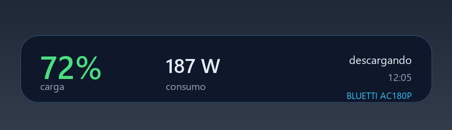

# BluettiWidget — app Android + widget para el BLUETTI AC180P

App Android **ultraligera** (APK de ~85 KB, sin dependencias ni Google Play
Services) que se conecta por Bluetooth LE al BLUETTI AC180P y muestra:

- **% de carga** y **consumo actual (W)** en la app y en un **widget** de la
  pantalla de inicio.
- Estado (cargando / descargando / reposo), entrada de red/solar y hora de la
  última lectura.
- **El widget se actualiza cada 5 minutos** mediante un servicio en primer
  plano (la única forma fiable en Android; WorkManager no baja de 15 min).

Sin nube, sin telemetría, sin cuentas. Todo se queda en el móvil.



> **Estado:** el protocolo (MODBUS + handshake cifrado BLE) está validado con
> una autoprueba contra vectores de la implementación de referencia y una
> simulación completa del intercambio. **Falta la prueba en un móvil real**
> (durante el desarrollo no había ningún Android conectado al PC). Si algo
> falla, el registro dentro de la app ayuda a diagnosticarlo.

## Instalación

1. Copia `dist/BluettiWidget.apk` al móvil (cable, Drive, Telegram…).
2. Ábrelo desde el gestor de archivos y acepta **instalar apps de origen
   desconocido** para esa aplicación.
3. Al abrir la app concede los permisos: **Dispositivos cercanos**
   (Bluetooth), **Notificaciones** y, en Android 11 o inferior, **Ubicación**.

El APK va firmado con una clave de depuración (`android/debug.keystore`), no es
para Google Play. Para actualizarlo conserva ese keystore (o usa siempre el
mismo APK).

## Primer uso

1. Enciende el AC180P y déjalo cerca.
2. Abre **Bluetti** → **Buscar dispositivo** → elige el `AC180P…` de la lista.
3. **Actualizar ahora** para confirmar que lee bien (carga y vatios).
4. **Activar actualización cada 5 min**. Aparecerá una notificación persistente
   (es obligatoria para que Android no duerma el proceso). La notificación
   muestra el estado y tiene acciones *Actualizar* y *Detener*.
5. Añade el widget: mantén pulsado un hueco del escritorio → **Widgets** →
   **Bluetti**. El widget se actualiza solo cada 5 minutos.

Sin el equipo a mano puedes pulsar **Modo demo** para ver la app y el widget
funcionando con datos simulados.

## Cómo funciona

- Mismas características BLE que la versión de Windows (`ff01` notificaciones,
  `ff02` escritura) y mismas tramas MODBUS: SOC (reg. 102), modelo (110) y
  potencias (140/142/144/146).
- El AC180P detectado usa **canal BLE cifrado** (ECDH P-256 + AES-CBC). El
  handshake está portado a Java desde `bluetti-bt-lib` (MIT) y cubierto por la
  autoprueba (`tools/ProtocolSelfTest.java`).
- Cada actualización abre una conexión, lee los registros y se desconecta.
- La app detecta el cifrado automáticamente, guarda la dirección del equipo y,
  si el equipo cambia de dirección BLE, lo reencuentra por nombre.
- El widget guarda el último estado en `SharedPreferences`; si el servicio se
  detiene, el widget muestra la última lectura con la hora (no inventa datos).

## Límites y notas

- El AC180P admite **una conexión BLE a la vez**: mientras la app lee, la app
  oficial de BLUETTI en el móvil puede no conectar (y viceversa).
- Android puede matar el servicio en algunos fabricantes (Xiaomi, Huawei…).
  Si el widget deja de actualizarse, desactiva la optimización de batería para
  **Bluetti** en los ajustes del sistema.
- El intervalo es de 5 minutos *de reloj*: cada ciclo incluye los segundos de
  la lectura.
- Tras reiniciar el móvil, si el servicio estaba activo se intenta reanudar
  automáticamente; si el fabricante lo bloquea, abre la app una vez.
- En Android 11 o inferior el **escaneo** puede requerir la ubicación activada;
  para leer el equipo ya emparejado/configurado no hace falta escanear.

## Diagnóstico

Dentro de la app: botón **Registro** (los últimos eventos, direcciones y
errores). Errores habituales:

| Mensaje | Causa |
| --- | --- |
| `permisos de Bluetooth denegados` | Concede "Dispositivos cercanos". |
| `no se pudo conectar` | AC180P apagado, fuera de alcance o conectado a otro dispositivo. |
| `el equipo no completó el canal cifrado` | Falló el handshake; prueba a acercar el móvil y reintentar. |
| `sin respuesta del equipo (registro N)` | La conexión se cortó a mitad de lectura (señal débil). |

## Compilar

No usa Gradle. Toolchain mínimo (JDK 17 + platform 34 + build-tools 34):

```powershell
.\setup_toolchain.ps1   # una sola vez: descarga JDK/SDK a %LOCALAPPDATA%\BluettiAndroid
.\build.ps1             # autoprueba + compila + firma -> dist\BluettiWidget.apk
```

`build.ps1` ejecuta antes la **autoprueba del protocolo** (MODBUS, AES,
ECDH, firmas y un handshake cifrado simulado) y falla si algo no cuadra.

### Estructura

```
app/src/main/java/com/striderskynet/bluetti/
  BluettiClient.java   BLE: escaneo, conexión, handshake y lecturas
  BluettiCrypto.java   handshake cifrado (ECDH P-256 + AES-CBC)
  Modbus.java          tramas MODBUS RTU y CRC16
  PollService.java     servicio en primer plano cada 5 min
  WidgetProvider.java  widget (RemoteViews)
  MainActivity.java    interfaz
  Prefs.java           ajustes + último estado
  Logs.java            registro local
app/src/main/res/      layouts, widget, iconos
tools/ProtocolSelfTest.java
```

### Créditos

Protocolo y criptografía basados en
[`bluetti-bt-lib`](https://github.com/Patrick762/bluetti-bt-lib) (MIT) y en el
trabajo original de `bluetti_mqtt` (warhammerkid, nhurman, jesherman). Esta app
es un proyecto no oficial, sin relación con BLUETTI.
